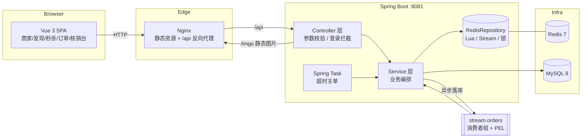

# 听风生活志 · tfshz

> 一个仿大众点评的**本地生活平台**：查商家、看探店笔记、抢秒杀券、下单点单、到店扫码核销。
> 后端 Spring Boot 3 + MyBatis-Plus + MySQL + Redis（Lua / Stream / Redisson / Caffeine），前端 Vue 3 + TypeScript + Vite。

这个项目刻意把两条最容易出事的链路做成了**有兜底、有数据、可复现**的工程实现：

- **高并发写**：秒杀券（Redis 预扣 + Lua 原子 + Redis Stream 异步落库），订单生命周期（Spring Task 关单 + 版本号 CAS）。
- **热点读**：多级缓存（Caffeine + Redis）、逻辑过期防击穿、空值防穿透、更新后删缓存 + 消息补偿。

---

## 目录

- [1. 技术栈](#1-技术栈)
- [2. 系统架构](#2-系统架构)
- [3. 核心设计](#3-核心设计)
  - [3.1 登录与会话：双 Token + 可撤销](#31-登录与会话双-token--可撤销)
  - [3.2 多级缓存与一致性](#32-多级缓存与一致性)
  - [3.3 高并发秒杀](#33-高并发秒杀)
  - [3.4 订单生命周期与并发控制](#34-订单生命周期与并发控制)
- [4. 实测数据](#4-实测数据)
- [5. 设计取舍 FAQ](#5-设计取舍-faq)
- [6. 快速开始](#6-快速开始)
- [7. 项目结构](#7-项目结构)
- [8. 接口一览](#8-接口一览)
- [9. 已知边界与后续规划](#9-已知边界与后续规划)

---

## 1. 技术栈

| 层次 | 选型 | 用来做什么 |
|---|---|---|
| 后端框架 | Spring Boot 3.5 / Java 17 | Web、依赖注入、定时任务、配置 |
| 持久层 | MyBatis-Plus 3.5 + MySQL 8 | CRUD、条件更新（乐观锁风格的原子扣减） |
| 缓存 | Redis 7 + Caffeine | 二级缓存、逻辑过期、空值缓存、分布式锁、Stream |
| 并发控制 | Redis Lua / Redisson / DB 条件更新 + 版本号 CAS | 原子扣减、一人一单、状态流转互斥 |
| 异步消息 | Redis Stream（消费者组 + PEL） | 订单异步落库、缓存删除补偿、死信与重试 |
| 认证 | JJWT（HS256）+ Redis | 双 Token（access/refresh）、刷新轮换、强制下线 |
| 调度 | Spring Task（`@Scheduled`） | 超时未支付订单自动关闭 + 库存回补 |
| 前端 | Vue 3 / TypeScript / Vite / Pinia / Vue Router | 商家、发现、秒杀、下单、订单二维码、核销台 |
| 部署 | Nginx（静态 + 反向代理）、pnpm | 前端构建产物托管、`/api` `/imgs` 代理 |

> 说明：消息中间件用的是 **Redis Stream**，没有引入 Kafka/RabbitMQ。理由见 [§5 设计取舍](#5-设计取舍-faq)。

---

## 2. 系统架构



**读路径**：浏览器 → Nginx → Spring Boot → `CacheClient`（Caffeine → Redis → MySQL 逐级回填）。
**写路径**：更新 MySQL → 删 Redis（失败则写 `stream.cache-delete` 补偿）→ 本地缓存靠 5s TTL 自愈。
**秒杀路径**：Lua 原子「校验 + 预扣 + 入队」→ 立即返回订单号 → Stream 消费者异步落库。

---

## 3. 核心设计

> 每一节都按「问题 → 方案 → 关键实现 → 边界」组织，便于快速看清取舍。

### 3.1 登录与会话：双 Token + 可撤销

**问题**：无状态 JWT 便宜但撤不掉；Redis Session 可撤销但每个请求都要查 Redis。

**方案**：两种 token 分工。

| Token | 有效期 | 校验方式 | 撤销能力 |
|---|---|---|---|
| access token | 30 min | **本地验签**（零 Redis 访问） | 到期自然失效 |
| refresh token | 7 天 | Redis 白名单 `login:refresh:{userId}:{jti}` | 登出/风控可立即删除 |

**关键实现**

- 签发：`JwtUtils` 里 payload 只放 `sub(userId) / jti / type / 昵称 / 头像`，不放手手机号等敏感字段；
- 刷新：`UserServiceImpl#refreshToken` 先查白名单，再**轮换**（旧 refresh 立即作废、签发新的一对）。
  旧 refresh 再次出现只有两种可能：客户端并发 bug 或 token 泄露 —— 学习项目里直接拒绝，生产环境建议顺手清空该用户全部 refresh 强制重登；
- 登出：`keys(login:refresh:{userId}:*)` 全删，等价于「踢掉所有设备」；
- 拦截器分工：`RefreshTokenInterceptor`（order 0）只解析 token、填充 `UserHolder`，放行所有请求；`LoginInterceptor`（order 1）负责 401。

**边界**：access token 在有效期内无法作废（最多再活 30 min），这是性能换来的确定性代价；需要秒级踢人就得加 access 黑名单（Redis 一次查询），项目里预留了 key 但没启用。

### 3.2 多级缓存与一致性

**问题**：热点券列表 QPS 高，直连 Redis/MySQL 都会被击穿。

**方案**：`CacheClient` 提供四种查询策略，按数据特征选用。

| 策略 | 用于 | 解决的故障 |
|---|---|---|
| `queryWithPassThrough` | 普通详情 | 缓存**穿透**（空值缓存 + 短 TTL） |
| `queryWithLogicalExpire` | 热点券列表 | 缓存**击穿**（逻辑过期 + 异步重建） |
| `queryWithMutex` | 回源代价极高的数据 | 击穿（互斥锁串行重建） |
| `queryWithMultiLevel` | 店铺券列表 | Redis 压力（Caffeine 本地命中，纳秒级） |

**一致性**：更新 MySQL 后**删缓存**（Cache-Aside），删除失败时写 `stream.cache-delete`，消费者按阶梯重试（1s/2s/4s…，上限 10 次），本地缓存靠 **5s TTL** 自愈，Redis 侧还有 TTL 兜底 —— 最终一致，不做强一致（强一致要 2PC/订阅 binlog，成本远大于收益）。

**关键实现**：`utils/CacheClient.java`、`utils/CacheDeleteCompensator.java`、`Service/impl/VoucherServiceImpl.java`。

### 3.3 高并发秒杀

**问题**：同一张券 200 人同时抢 50 份，要保证不超卖、不重复、不丢单。

**方案**：三层递进。

```
① 资格判定 + 库存预扣 + 订单入队   一次 EVAL 完成（Redis 单线程 = 天然原子）
② 订单落库                           Redis Stream 消费者组异步处理 + XACK
③ 兜底                               DB 条件更新 stock>0 / Redisson 锁 / 唯一索引
```

**Lua 脚本**（`resources/lua/seckill.lua`）：时间窗 → 一人一单 → 库存预扣 → `XADD` 入队，返回码 `0 成功 / 1 库存不足 / 2 重复下单 / 3 未开始 / 4 已结束 / -2 未预热`。

**关键点**

- `GET` 库存 key 不存在时返回 `false`，`tonumber(false)` 是 nil 会直接抛脚本错 —— 必须 `or '-1'` 兜底，并靠 [库存预热] 保证 key 存在（启动全量 + 请求懒加载，已存在不覆盖）；
- 落库侧用 **条件更新** `UPDATE stock = stock - 1 WHERE voucher_id = ? AND stock > 0` 保证即使 Redis 预扣算错也不会超卖，再用 **Redisson 锁**把「同一用户同一张券」的落库串行化，最后 `uk_user_voucher` 唯一索引兜底；
- 消息可靠性：手动 `XACK`；处理失败**不 ACK**、留在 PEL，定时任务扫 `XPENDING` 并对空闲 > 60s 的消息 `XCLAIM` 认领重试；投递 ≥ 5 次仍失败则回滚预扣 + 进死信 `stream.orders.dlq`，避免毒消息堵队列；
- 业务失败（DB 库存不足/重复下单）用 `lua/seckill_rollback.lua` 把预扣原路退回，库存不被失败订单吃掉。

**边界**：Redis 整体不可用时秒杀不可用（Lua 与锁都依赖 Redis），此时接口返回"活动未就绪"，不会退化成超卖的 DB 直写。

### 3.4 订单生命周期与并发控制

**问题**：用户支付和系统关单可能同时发生，必须二选一，不能出现「既已支付又已关闭」。

**方案**：状态机 + 版本号 CAS。

```
1 待支付 ──支付(CAS)──▶ 2 已支付 ──核销(CAS)──▶ 3 已核销
    │
    ├──用户取消(CAS)──▶ 4 已关闭
    └──超时关单(CAS + 回补库存)──▶ 4 已关闭
```

**关键实现**

- 所有状态流转都是一条 SQL：

```sql
UPDATE tb_product_order
   SET status = ?, version = version + 1, ...
 WHERE id = ? AND status = ? AND version = ?
```

  影响行数为 1 才代表"本次调用赢了"；失败就重读订单再判断（重试上限 3 次），把冲突翻译成「订单已超时关闭」这类准确提示；
- **回补库存必须被关单成功门控**：CAS 成功才退库存，否则会出现「订单已支付、库存却退回去了」的资损；
- 定时任务只做扫描，写操作放在 Service 的独立事务方法里（`@Transactional` 走代理，同类自调用会失效）；
- `fixedDelay` 而非 `fixedRate`，避免任务堆积；单次批量上限 200。

**统一到两类订单**：商品订单（`tb_product_order`）和秒杀券订单（`tb_voucher_order`）共用同一套支付（`PayService` 抽象 + Mock 实现）、核销（核销码前缀 `P`/`V`，统一入口 `POST /order/verify/{code}`）、超时关单（`OrderTimeoutTask` 同时扫两张表）。

**边界**：CAS 保证"不会既支付又关闭"，但保证不了钱 —— 第三方已扣款而订单已关闭时，必须靠「查单 + 退款」补偿（项目里保留了 `tradeNo` 字段与 `/pay/notify` 回调入口）。

---

## 4. 实测数据

> 单机本地实测（本机 MySQL + Redis + 单实例后端），用于验证正确性而非做性能背书。

**秒杀：200 个不同用户抢 50 份库存**

| 指标 | 结果 |
|---|---|
| 成功 / 失败 | 50 成功，150 返回「库存不足」 |
| 总耗时 | 约 610 ms（200 并发请求） |
| DB 订单行数 / 去重用户 | 50 / 50 |
| 库存（DB / Redis） | 0 / 0，未出现负数 |
| Stream 消息数 / PEL 残留 / 死信 | 50 / 0 / 0 |

**并发正确性**

| 场景 | 结果 |
|---|---|
| 同一用户并发 10 次抢券 | 1 成功，9 次「不能重复下单」 |
| 同一订单 10 并发（5 支付 + 5 关单） | 每单 `version` 只 +1，最终状态要么 2 要么 4，无错乱 |
| 消息不 ACK 后重启消费者 | 约 60s 空闲后被 `XCLAIM` 认领并成功落库，PEL 归零 |
| 超时未支付订单 | Spring Task 自动关闭，DB 与 Redis 库存同步 +1 |

**缓存**：本地缓存命中为纳秒级（进程内），Redis 命中 ~0.3ms，回源 MySQL ~2ms（本地开发环境量级）。

---

## 5. 设计取舍 FAQ

**Q：为什么用 Redis Stream，而不是 Kafka / RabbitMQ？**
单机项目里引入 Kafka 需要额外维护 broker + zookeeper/KRaft、序列化协议、监控与重平衡，运维成本远大于收益；而本项目的异步需求是「低延迟、可重放、按消费者组分摊、失败可重试」，Redis Stream 的消费者组 + PEL + `XCLAIM` 正好覆盖，且与已在用的 Redis 复用同一套运维。真正的取舍是：**消息量 > 10w/s、需要分区顺序或跨系统分发时，才应该换成 Kafka**。

**Q：既然有 `status = 期望值`，为什么还要 `version`？**
`status` 只能保证"这一步该不该走"（单向前进时已经够用）；`version` 保证"我读到的这行还是不是最新" —— 当同一条 SQL 里还要更新别的字段，或将来允许状态回退（退款/重开）时，只有版本号能判冲突。它同时也是「这一行被成功改过几次」的可观测证据。

**Q：缓存为什么删而不是更新？**
删除让并发写天然幂等（删两次 = 删一次），更新则可能因执行顺序错乱写入旧值；删除失败再用消息队列补偿 + TTL 兜底。

**Q：秒杀的库存为什么要 Redis 和 DB 两份？**
Redis 承担"瞬时流量消峰"（内存操作 + Lua 原子），DB 承担"最终事实"（条件更新 + 唯一索引）。两者短暂不一致是可接受的设计，靠「预扣回滚」与「对账」收敛，而不是要求强一致 —— 强一致必然要行锁，热点行锁会把 QPS 打回个位数。

**Q：为什么抢券接口返回的是字符串订单号？**
订单号是 19 位（时间戳 + 序列号），超过 JS `Number.MAX_SAFE_INTEGER`，直接返回 number 会在前端丢精度（联调时真的踩到：查详情用的 id 和落库 id 对不上）。

---

## 6. 快速开始

### 6.1 环境

| 组件 | 版本 | 端口 |
|---|---|---|
| JDK | 17 | - |
| Maven | 3.8+ | - |
| MySQL | 8.x | 3306 |
| Redis | 6/7 | 6379 |
| Node.js | 18+ | - |

### 6.2 初始化数据库

```bash
# 建库 + 建表 + 种子数据（103茶餐厅 7 个商品、1 张秒杀券）
mysql -uroot -p < DB/tfshz.sql
```

增量脚本（已包含在完整 dump 中，单独执行也安全）：

- `BackEnd/tfshz/sql/product_order.sql` —— 商品/订单/订单明细 + 商品种子
- `BackEnd/tfshz/sql/voucher_order_upgrade.sql` —— 券订单升级为完整生命周期（核销码、版本号、支付截止）

### 6.3 启动后端

```bash
cd BackEnd/tfshz
mvn spring-boot:run        # 或 IDEA 直接运行 TfShengHouZhiApplication
```

数据库/Redis 连接在 `src/main/resources/application.yaml`，支持环境变量覆盖：`DB_URL`、`DB_USERNAME`、`DB_PASSWORD`、`REDIS_HOST`、`REDIS_PORT`、`REDIS_PASSWORD`、`JWT_SECRET`。

### 6.4 启动前端

```bash
cd devFE
pnpm install
pnpm dev                   # http://127.0.0.1:5173
```

Vite 已把 `/api`、`/imgs`、`/types` 代理到后端，图片不会 404。

### 6.5 走一遍主流程

1. 登录（短信验证码 `POST /user/code` 会把验证码写进 Redis，开发环境可从日志/Redis 取）；
2. 首页 → 找店 → **103茶餐厅**：浏览商品、加购物车、结算；
3. 订单页 → 立即支付（Mock 通道）→ 得到核销二维码；
4. 「我的」→ 我的订单（商品单与券单混排）→ 看核销码；
5. 「核销台」输入/扫码核销；
6. 券订单同理：店铺页点「抢购」→ 订单页支付 → 核销。

---

## 7. 项目结构

```
tfshz/
├── BackEnd/tfshz/                     # 后端（Spring Boot 3）
│   ├── src/main/java/com/tfsh/
│   │   ├── config/                    # 拦截器注册、全局异常
│   │   ├── controller/                # 商家 / 笔记 / 券 / 订单 / 核销 / 支付回调
│   │   ├── Service/impl/              # 业务实现（含秒杀入口、订单生命周期）
│   │   ├── seckill/                   # 预热、落库、Stream 消费者、消息处理器、预扣回滚
│   │   ├── order/                     # 订单状态、CAS 核销服务、核销码生成
│   │   ├── pay/                       # 支付通道抽象 + Mock 实现（预留真实支付）
│   │   ├── task/                       # Spring Task 超时关单
│   │   ├── entity/ dto/ mapper/        # 数据模型与出入参
│   │   └── utils/                      # JWT、缓存、ID 生成、Redis 常量
│   ├── src/main/resources/
│   │   ├── lua/                        # seckill.lua / seckill_rollback.lua
│   │   └── application.yaml
│   └── sql/                            # 增量迁移脚本
├── DB/tfshz.sql                       # 完整建库脚本（含种子数据）
├── devFE/                             # 前端（Vue 3 + TS + Vite）
│   └── src/{views,components,services,stores,types,utils,vendor}
├── FrontEnd/nginx-1.18.0/             # 本地 Nginx（静态资源 / 反向代理）
└── README.md
```

---

## 8. 接口一览

| 模块 | 方法 & 路径 | 说明 |
|---|---|---|
| 认证 | `POST /user/code` | 发送短信验证码（写 Redis，2 分钟有效） |
| | `POST /user/login` | 登录，返回 access + refresh |
| | `POST /user/refresh` | 刷新（轮换 refresh） |
| | `POST /user/logout` | 登出（清空该用户全部 refresh） |
| 商家 | `GET /shop/list`、`GET /shop/{id}`、`GET /shop/of/type` | 列表 / 详情 / 分类 |
| 商品 | `GET /product/of/shop/{shopId}` | 店铺在架商品（免登录） |
| 秒杀券 | `POST /voucher-order/seckill/{id}` | 抢券（Lua 预扣 + 入队） |
| | `GET /voucher-order/list` | 我的券订单 |
| | `POST /voucher-order/{id}/pay` | 支付券订单 |
| 商品订单 | `POST /product-order` | 下单（条件更新扣库存） |
| | `GET /product-order/list`、`GET /product-order/{id}` | 我的订单 / 详情 |
| | `POST /product-order/{id}/pay` | 支付（Mock 通道） |
| | `POST /product-order/{id}/cancel` | 取消（CAS + 回补库存） |
| 核销 | `POST /order/verify/{code}` | **统一核销**：商品单和券单共用 |
| 回调 | `POST /pay/notify` | 第三方支付回调（预留，需验签） |
| 运维 | `POST /product-order/task/close-expired` | 手动触发一轮超时关单 |
| 收藏/优惠券 | `PUT /shop-favorite/{shopId}/{isFavorite}`、`GET /shop-favorite/list`、`GET /voucher-order/list` | 店铺收藏、我的券 |

---

## 9. 已知边界与后续规划

诚实地列出这套实现「还差什么」，比堆功能更能说明工程判断：

| 类别 | 现状 | 改进方向 |
|---|---|---|
| 支付 | Mock 通道，付款即成功 | 接微信/支付宝：`prepay` 换统一下单、回调加**验签**、补**查单 + 退款**（订单已关闭但已扣款） |
| 调度 | 单机 Spring Task，多实例会重复扫（CAS 保证不出错但浪费） | XXL-JOB / 延迟消息，把"谁来扫"也变成协调问题 |
| 库存对账 | 依赖预扣回滚与死信人工介入 | 定时比对 `DB 库存 + 未支付订单` 与 Redis 库存，不一致告警 |
| 可观测 | 日志 + 死信队列 | 埋点（秒杀成功率、PEL 水位、死信数）、Prometheus + Grafana |
| 测试 | 手工压测脚本 | 单测（CAS/状态机边界）+ 集成测试（Testcontainers）+ 压测脚本入库 |
| 部署 | 本地 Nginx + IDEA 运行 | `docker-compose` 一键起 MySQL/Redis/后端/前端 |
| 限流 | 无 | 网关/接口级令牌桶，防刷接口（验证码、下单） |
| 接口文档 | README + 代码 | OpenAPI 3（springdoc）自动生成 |

---

## License

[MIT](LICENSE)
