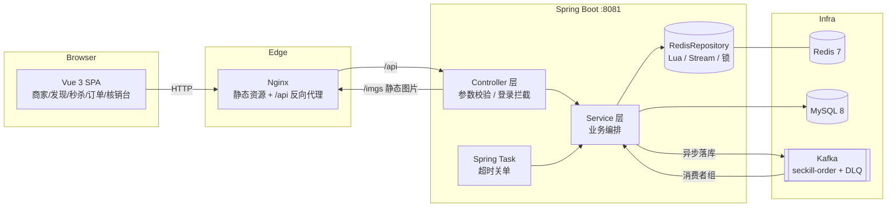

# 听风生活志 · tfshz

> 一个仿大众点评的**本地生活平台**：查商家、看探店笔记、抢秒杀券、下单点单、到店扫码核销。
> 后端 Spring Boot 3 + MyBatis-Plus + MySQL + Redis（Lua / Stream / Redisson / Caffeine），前端 Vue 3 + TypeScript + Vite。

这个项目刻意把两条最容易出事的链路做成了**有兜底、有数据、可复现**的工程实现：

- **高并发写**：秒杀券（Redis 预扣 + Lua 原子 + **Kafka 异步落库**），订单生命周期（Spring Task 关单 + 版本号 CAS）。
- **热点读**：多级缓存（Caffeine + Redis）、逻辑过期防击穿、空值防穿透、更新后删缓存 + 消息补偿。

---

## 目录

- [1. 技术栈](#1-技术栈)
- [2. 系统架构](#2-系统架构)
- [3. 核心设计](#3-核心设计)
  - [3.1 登录与会话：双 Token + 可撤销](#31-登录与会话双-token--可撤销)
  - [3.2 多级缓存与一致性](#32-多级缓存与一致性)
  - [3.3 高并发秒杀](#33-高并发秒杀)
  - [3.4 订单生命周期与并发控制](#34-订单生命周期与并发控制)
  - [3.5 可观测性：把秒杀链路变成能查询的系统](#35-可观测性把秒杀链路变成能查询的系统)
- [4. 实测数据](#4-实测数据)
- [5. 设计取舍 FAQ](#5-设计取舍-faq)
- [6. 快速开始](#6-快速开始)
- [7. 项目结构](#7-项目结构)
- [8. 接口一览](#8-接口一览)
- [9. 已知边界与后续规划](#9-已知边界与后续规划)

---

## 1. 技术栈

| 层次 | 选型 | 用来做什么 |
|---|---|---|
| 后端框架 | Spring Boot 3.5 / Java 17 | Web、依赖注入、定时任务、配置 |
| 持久层 | MyBatis-Plus 3.5 + MySQL 8 | CRUD、条件更新（乐观锁风格的原子扣减） |
| 缓存 | Redis 7 + Caffeine | 二级缓存、逻辑过期、空值缓存、分布式锁 |
| 并发控制 | Redis Lua / Redisson / DB 条件更新 + 版本号 CAS | 原子扣减、一人一单、状态流转互斥 |
| 异步消息 | **Kafka**（消费组 / AckMode.RECORD / 重试 / DLQ） | 秒杀订单异步落库；**Redis Stream 作为可切换备选**（`seckill.mq=stream`） |
| 认证 | JJWT（HS256）+ Redis | 双 Token（access/refresh）、刷新轮换、强制下线 |
| 调度 | Spring Task（`@Scheduled`） | 超时未支付订单自动关闭 + 库存回补 |
| 可观测性 | Spring Boot Actuator + Micrometer + Prometheus | 秒杀分流计数、落库结果、死信数、Kafka 消费 LAG |
| 测试 | JUnit 5 + Mockito + **Testcontainers** | 32 个单测 + 4 个端到端集成测试（真实 MySQL/Redis/Kafka） |
| 部署 | Docker Compose / Nginx / pnpm | 一键起 MySQL + Redis + Kafka + 后端 + 前端（图片随镜像打包） |
| 压测 | JMeter（`.jmx` + 脚本生成 token） | 秒杀链路并发验证：不超卖、不重复、不丢单 |

> 消息中间件默认 **Kafka**，同时保留了一套 **Redis Stream** 实现，用配置 `seckill.mq` 切换。为什么以及两者的取舍见 [§5 设计取舍](#5-设计取舍-faq)。

---

## 2. 系统架构



**读路径**：浏览器 → Nginx → Spring Boot → `CacheClient`（Caffeine → Redis → MySQL 逐级回填）。
**写路径**：更新 MySQL → 删 Redis（失败则写 `stream.cache-delete` 补偿）→ 本地缓存靠 5s TTL 自愈。
**秒杀路径**：Lua 原子「校验 + 预扣」→ 投递 Kafka 消息 → 立即返回订单号 → 消费者组异步落库（重试 / 死信兜底）。

---

## 3. 核心设计

> 每一节都按「问题 → 方案 → 关键实现 → 边界」组织，便于快速看清取舍。

### 3.1 登录与会话：双 Token + 可撤销

**问题**：无状态 JWT 便宜但撤不掉；Redis Session 可撤销但每个请求都要查 Redis。

**方案**：两种 token 分工。

| Token | 有效期 | 校验方式 | 撤销能力 |
|---|---|---|---|
| access token | 30 min | **本地验签**（零 Redis 访问） | 到期自然失效 |
| refresh token | 7 天 | Redis 白名单 `login:refresh:{userId}:{jti}` | 登出/风控可立即删除 |

**关键实现**

- 签发：`JwtUtils` 里 payload 只放 `sub(userId) / jti / type / 昵称 / 头像`，不放手手机号等敏感字段；
- 刷新：`UserServiceImpl#refreshToken` 先查白名单，再**轮换**（旧 refresh 立即作废、签发新的一对）。
  旧 refresh 再次出现只有两种可能：客户端并发 bug 或 token 泄露 —— 学习项目里直接拒绝，生产环境建议顺手清空该用户全部 refresh 强制重登；
- 登出：`keys(login:refresh:{userId}:*)` 全删，等价于「踢掉所有设备」；
- 拦截器分工：`RefreshTokenInterceptor`（order 0）只解析 token、填充 `UserHolder`，放行所有请求；`LoginInterceptor`（order 1）负责 401。

**边界**：access token 在有效期内无法作废（最多再活 30 min），这是性能换来的确定性代价；需要秒级踢人就得加 access 黑名单（Redis 一次查询），项目里预留了 key 但没启用。

### 3.2 多级缓存与一致性

**问题**：热点券列表 QPS 高，直连 Redis/MySQL 都会被击穿。

**方案**：`CacheClient` 提供四种查询策略，按数据特征选用。

| 策略 | 用于 | 解决的故障 |
|---|---|---|
| `queryWithPassThrough` | 普通详情 | 缓存**穿透**（空值缓存 + 短 TTL） |
| `queryWithLogicalExpire` | 热点券列表 | 缓存**击穿**（逻辑过期 + 异步重建） |
| `queryWithMutex` | 回源代价极高的数据 | 击穿（互斥锁串行重建） |
| `queryWithMultiLevel` | 店铺券列表 | Redis 压力（Caffeine 本地命中，纳秒级） |

**一致性**：更新 MySQL 后**删缓存**（Cache-Aside），删除失败时写 `stream.cache-delete`，消费者按阶梯重试（1s/2s/4s…，上限 10 次），本地缓存靠 **5s TTL** 自愈，Redis 侧还有 TTL 兜底 —— 最终一致，不做强一致（强一致要 2PC/订阅 binlog，成本远大于收益）。

**关键实现**：`utils/CacheClient.java`、`utils/CacheDeleteCompensator.java`、`Service/impl/VoucherServiceImpl.java`。

### 3.3 高并发秒杀

**问题**：同一张券 200 人同时抢 50 份，要保证不超卖、不重复、不丢单。

**方案**：三层递进。

```
① 资格判定 + 库存预扣        一次 EVAL 完成（Redis 单线程 = 天然原子）
② 订单消息投递 + 异步落库     Kafka（消费组 / AckMode.RECORD / 重试 / DLQ）
③ 兜底                       DB 条件更新 stock>0 / Redisson 锁 / 唯一索引
```

**Lua 脚本**（`resources/lua/seckill.lua`）：时间窗 → 一人一单 → 库存预扣，返回码 `0 成功 / 1 库存不足 / 2 重复下单 / 3 未开始 / 4 已结束 / -2 未预热`。

**关键点**

- `GET` 库存 key 不存在时返回 `false`，`tonumber(false)` 是 nil 会直接抛脚本错 —— 必须 `or '-1'` 兜底，并靠库存预热保证 key 存在（启动全量 + 请求懒加载，已存在不覆盖）；
- **投递与预扣的取舍**：Lua 里不再 `XADD`，改由 Java 侧投递 Kafka（`SeckillOrderPublisher`），失败就回滚 Redis 预扣并返回"请重试"。代价是"预扣 → 投递"之间出现了一个可回滚的窗口，换来的是 MQ 与 Redis 解耦、可以换成 Kafka；
- 落库侧用 **条件更新** `UPDATE stock = stock - 1 WHERE voucher_id = ? AND stock > 0` 保证即使 Redis 预扣算错也不会超卖，再用 **Redisson 锁**把「同一用户同一张券」的落库串行化，最后 `uk_user_voucher` 唯一索引兜底；
- **Kafka 可靠性三件套**（`config/KafkaConfig`）：`AckMode.RECORD` 每条处理后提交 offset；`DefaultErrorHandler` 指数退避重试（1s/2s/4s，最多 3 次）后转发死信 `seckill-order-dlq` 并提交原 offset，避免堵住同分区后续消息；消息体格式错误这类**不可重试**异常直接进死信，不浪费重试次数；
- **幂等**：重复消费是允许发生的（at-least-once），靠 `orderId` 已存在直接返回、DB 条件扣减、唯一索引三重保证"多次重试 == 一次效果"；业务失败回滚预扣时用 `seckill:rolledback:{orderId}` 做一次性守卫，避免重投导致库存被重复 `INCR`；
- 业务失败（DB 库存不足/重复下单）用 `lua/seckill_rollback.lua` 把预扣原路退回，并写一条带原因的**业务死信**，便于对账。

**边界**：Redis 整体不可用时秒杀不可用（Lua 与锁都依赖 Redis），此时接口返回"活动未就绪"，不会退化成超卖的 DB 直写；Kafka 不可用时投递失败会回滚预扣并提示重试，不会"扣了库存没下单"。

### 3.4 订单生命周期与并发控制

**问题**：用户支付和系统关单可能同时发生，必须二选一，不能出现「既已支付又已关闭」。

**方案**：状态机 + 版本号 CAS。

```
1 待支付 ──支付(CAS)──▶ 2 已支付 ──核销(CAS)──▶ 3 已核销
    │
    ├──用户取消(CAS)──▶ 4 已关闭
    └──超时关单(CAS + 回补库存)──▶ 4 已关闭
```

**关键实现**

- 所有状态流转都是一条 SQL：

```sql
UPDATE tb_product_order
   SET status = ?, version = version + 1, ...
 WHERE id = ? AND status = ? AND version = ?
```

  影响行数为 1 才代表"本次调用赢了"；失败就重读订单再判断（重试上限 3 次），把冲突翻译成「订单已超时关闭」这类准确提示；
- **回补库存必须被关单成功门控**：CAS 成功才退库存，否则会出现「订单已支付、库存却退回去了」的资损；
- 定时任务只做扫描，写操作放在 Service 的独立事务方法里（`@Transactional` 走代理，同类自调用会失效）；
- `fixedDelay` 而非 `fixedRate`，避免任务堆积；单次批量上限 200。

**统一到两类订单**：商品订单（`tb_product_order`）和秒杀券订单（`tb_voucher_order`）共用同一套支付（`PayService` 抽象 + Mock 实现）、核销（核销码前缀 `P`/`V`，统一入口 `POST /order/verify/{code}`）、超时关单（`OrderTimeoutTask` 同时扫两张表）。

**边界**：CAS 保证"不会既支付又关闭"，但保证不了钱 —— 第三方已扣款而订单已关闭时，必须靠「查单 + 退款」补偿（项目里保留了 `tradeNo` 字段与 `/pay/notify` 回调入口）。

### 3.5 可观测性：把秒杀链路变成能查询的系统

**问题**：秒杀出问题时，"卖了多少、被什么挡下、消息有没有积压"只能翻日志和手敲 `kafka-consumer-groups`。

**方案**：Actuator + Micrometer 暴露 Prometheus 指标，三个自定义计数器 + Kafka 客户端自带的 LAG 指标。

| 指标 | 类型 | 标签 | 用来回答 |
|---|---|---|---|
| `seckill_requests_total` | Counter | `result` = success / stock_empty / duplicate / not_started / ended / publish_failed / lua_error / fallback_sync | 抢购被什么挡下的（比只看成功率有用） |
| `seckill_order_persist_total` | Counter | `outcome` = success / already_exists / user_duplicate / stock_exhausted / invalid | 消费端落库的真实结果（含幂等跳过） |
| `seckill_dead_letter_total` | Counter | `reason` = duplicate / stock_exhausted / invalid | 死信，**>0 就该告警** |
| `kafka_consumer_fetch_manager_records_lag_max` | Gauge（客户端自带） | `client_id` | 消费积压 |
| `http_server_requests_seconds` | Timer（Boot 自带） | `uri` / `status` | 接口 RT 与错误率 |

**关键实现**

- `seckill/SeckillMetrics.java`：**标签值都是固定枚举**，绝不用 `userId` / `orderId`，避免时间序列基数爆炸；
- Kafka 侧只加一行 `spring.kafka.listener.micrometer-enabled=true`，消费者的 lag / 拉取速率等指标就由客户端自动上报；
- 端点只在 `/actuator` 下暴露 `health,info,metrics,prometheus`，并在 `MvcConfig` 里放行；生产应再加网关白名单或独立管理端口。

```bash
curl -s localhost:8081/actuator/prometheus | grep -E 'seckill|records_lag_max'
# seckill_requests_total{result="success",...} 50.0
# seckill_order_persist_total{outcome="success",...} 50.0
# seckill_dead_letter_total{reason="stock_exhausted",...} 0.0
# kafka_consumer_fetch_manager_records_lag_max{...} NaN   # 还没拉取过是 NaN，稳定消费后为 0
```

**边界**：技术性死信（重试耗尽、由 `DefaultErrorHandler` 转发）不计入 `seckill_dead_letter_total`，需要靠 `kafka_consumer_fetch_manager_records_failed` 或 topic 位点观察；指标只做到"可查"，告警规则（Alertmanager）没在仓库里。

---

## 4. 实测数据

> 单机本地实测（本机 MySQL + Redis + 单实例后端），用于验证正确性而非做性能背书。

**秒杀：200 个不同用户抢 50 份库存（JMeter，`-Jthreads=200 -Jramp=1`）**

| 指标 | 结果 |
|---|---|
| 成功 / 失败 | 50 成功，150 返回「库存不足」 |
| 吞吐 / 平均 RT / 最大 RT | ≈ 147 req/s / 398 ms / 1.0 s（HTTP 层 0 错误） |
| DB 订单行数 / 去重用户 | 50 / 50 |
| 库存（DB / Redis） | 0 / 0，未出现负数 |
| Kafka 消息数 / 消费 LAG / 新增死信 | 50 / 0 / 0 |

**并发正确性**

| 场景 | 结果 |
|---|---|
| 同一用户并发 10 次抢券 | 1 成功，9 次「不能重复下单」 |
| 同一订单 10 并发（5 支付 + 5 关单） | 每单 `version` 只 +1，最终状态要么 2 要么 4，无错乱 |
| 生产一条坏消息（非 JSON） | 不参与重试，直接进 `seckill-order-dlq`，主 topic LAG 归 0 |
| 生产一条业务失败消息（券不存在） | 回滚预扣 + 写带原因的业务死信，主 topic 继续消费 |
| 超时未支付订单 | Spring Task 自动关闭，DB 与 Redis 库存同步 +1 |

**测试**：`mvn test` → **36 个用例全绿** = 32 个单测（状态机 CAS 边界、库存扣减边界、幂等分支、核销重复、关单回补门控）+ 4 个 **Testcontainers 端到端测试**（真实 MySQL/Redis/Kafka：抢券落库、一人一单、坏消息进死信、Prometheus 指标）；没有 Docker 的环境会自动跳过集成测试，不会把构建搞红。

**容器化验证**：`docker compose up -d --build` 后，`18080`（前端）、`/api` 反代、`/imgs` 图片、`18081`（后端）、`/actuator/prometheus` 均返回 200；通过 compose 后端抢券 → 订单经 Kafka 落进容器内 MySQL（`verify_code` 已生成、库存递减、消费组 LAG = 0）。

**缓存**：本地缓存命中为纳秒级（进程内），Redis 命中 ~0.3ms，回源 MySQL ~2ms（本地开发环境量级）。

---

## 5. 设计取舍 FAQ

**Q：为什么默认用 Kafka，而不是 Redis Stream？**

两套实现都在仓库里，用 `seckill.mq` 切换（`kafka` / `stream`）。选 Kafka 作为默认，是因为它的**消费语义是现成的**：

| 能力 | Kafka | Redis Stream |
|---|---|---|
| 消费进度 | broker 侧 offset + 消费组 | PEL + 手工 `XACK` |
| 失败重试 | `DefaultErrorHandler` 自动退避重投 | 自己扫 `XPENDING` + `XCLAIM` |
| 死信 | 转发到独立 topic，一行配置 | 自己写死信逻辑 |
| 横向扩展 | 增分区 + 增消费者即可 | Stream 不是真正的分区，扩展性弱 |
| 隔离性 | 独立进程，积压不影响缓存/锁 | 与缓存、锁共享同一个 Redis 内存 |
| 运维成本 | 多一个 broker（KRaft 单节点即可，compose 里已带） | 无额外组件 |

结论：**需要可靠异步 + 可重试 + 可扩展时用 Kafka；只有单机、量小、想少一个组件时才用 Stream**。保留 Stream 实现的意义是：MQ 抽象（`SeckillOrderPublisher`）真的可替换，而不是嘴上说解耦。

**Q：既然有 `status = 期望值`，为什么还要 `version`？**
`status` 只能保证"这一步该不该走"（单向前进时已经够用）；`version` 保证"我读到的这行还是不是最新" —— 当同一条 SQL 里还要更新别的字段，或将来允许状态回退（退款/重开）时，只有版本号能判冲突。它同时也是「这一行被成功改过几次」的可观测证据。

**Q：缓存为什么删而不是更新？**
删除让并发写天然幂等（删两次 = 删一次），更新则可能因执行顺序错乱写入旧值；删除失败再用消息队列补偿 + TTL 兜底。

**Q：秒杀的库存为什么要 Redis 和 DB 两份？**
Redis 承担"瞬时流量消峰"（内存操作 + Lua 原子），DB 承担"最终事实"（条件更新 + 唯一索引）。两者短暂不一致是可接受的设计，靠「预扣回滚」与「对账」收敛，而不是要求强一致 —— 强一致必然要行锁，热点行锁会把 QPS 打回个位数。

**Q：为什么抢券接口返回的是字符串订单号？**
订单号是 19 位（时间戳 + 序列号），超过 JS `Number.MAX_SAFE_INTEGER`，直接返回 number 会在前端丢精度（联调时真的踩到：查详情用的 id 和落库 id 对不上）。

---

## 6. 快速开始

### 6.1 一键启动（Docker Compose，推荐给面试官/评审）

```bash
docker compose up -d --build
# 前端 http://localhost:18080   后端 http://localhost:18081
# MySQL 3307 / Redis 6380 / Kafka 19092（刻意避开本机常用端口）
docker compose logs -f backend     # 看秒杀消费、关单任务的日志
docker compose down                # 停止（数据在 volume 里）；加 -v 连数据一起删
```

包含 MySQL（自动执行 `DB/tfshz.sql`）、Redis（带密码）、Kafka（KRaft 单节点）、后端（Dockerfile 多阶段构建）、前端（Nginx + SPA 回退 + `/api` 反代）。

- 图片：`imgs/` 已随代码入库（`BackEnd/tfshz/src/main/resources/static/imgs`），通过 `classpath:/static/imgs/` 提供，镜像里天然可用；需要额外放私有图片时用 `IMGS_LOCATION` 指向磁盘目录；
- 多环境共用同一个 Kafka 时，务必改 `KAFKA_GROUP`，否则本地后端和容器后端会加入同一个消费组互相抢分区。

### 6.2 本地开发环境

| 组件 | 版本 | 端口 |
|---|---|---|
| JDK | 17 | - |
| Maven | 3.8+ | - |
| MySQL | 8.x | 3306 |
| Redis | 6/7 | 6379 |
| Kafka | 3.8（KRaft 单节点即可） | 9092 |
| Node.js | 18+ | - |

### 6.3 初始化数据库

```bash
# 建库 + 建表 + 种子数据（103茶餐厅 7 个商品、1 张秒杀券）
mysql -uroot -p < DB/tfshz.sql
```

增量脚本（已包含在完整 dump 中，单独执行也安全）：

- `BackEnd/tfshz/sql/product_order.sql` —— 商品/订单/订单明细 + 商品种子
- `BackEnd/tfshz/sql/voucher_order_upgrade.sql` —— 券订单升级为完整生命周期（核销码、版本号、支付截止）

### 6.4 启动后端

```bash
cd BackEnd/tfshz
mvn spring-boot:run        # 或 IDEA 直接运行 TfShengHouZhiApplication
```

数据库/Redis/Kafka 连接在 `src/main/resources/application.yaml`，支持环境变量覆盖：`DB_URL`、`DB_USERNAME`、`DB_PASSWORD`、`REDIS_HOST`、`REDIS_PORT`、`REDIS_PASSWORD`、`KAFKA_SERVERS`、`SECKILL_MQ`（`kafka`/`stream`）、`JWT_SECRET`。

### 6.5 启动前端

```bash
cd devFE
pnpm install
pnpm dev                   # http://127.0.0.1:5173
```

Vite 已把 `/api`、`/imgs`、`/types` 代理到后端，图片不会 404。

### 6.6 走一遍主流程

1. 登录（短信验证码 `POST /user/code` 会把验证码写进 Redis，开发环境可从日志/Redis 取）；
2. 首页 → 找店 → **103茶餐厅**：浏览商品、加购物车、结算；
3. 订单页 → 立即支付（Mock 通道）→ 得到核销二维码；
4. 「我的」→ 我的订单（商品单与券单混排）→ 看核销码；
5. 「核销台」输入/扫码核销；
6. 券订单同理：店铺页点「抢购」→ 订单页支付 → 核销。

### 6.7 跑测试

```bash
cd BackEnd/tfshz
mvn test        # 36 个用例
# 32 个单测：状态机 CAS 边界 / 库存扣减边界 / 幂等 / 核销重复 / 关单回补门控
#  4 个集成测试（Testcontainers，需要本机 Docker；没有 Docker 会自动跳过）：
#    抢券→Kafka→落库、一人一单、坏消息进死信、Prometheus 指标
#  首次运行会拉取 mysql:8.0 / redis:7-alpine / confluentinc/cp-kafka 镜像
```

测试用 Mockito 打掉 Mapper 与中间件，不依赖任何外部服务；`MybatisPlusTestSupport` 负责初始化实体的 Lambda 元信息。

### 6.8 压测（JMeter）

```bash
cd loadtest
node gen-tokens.mjs --count 200 --start 940001 --out tokens.csv     # 每个用户一个 JWT（别用 > 重定向，会写成 UTF-16）
rm -f result.jtl && jmeter -n -t seckill.jmx -Jthreads=200 -Jramp=1 -Jvoucher=2 -l result.jtl -e -o report

# 没有本地 JMeter 时用容器（已验证可用）
docker run --rm -v "$PWD":/test -w /test justb4/jmeter:5.5 \
  -n -t seckill.jmx -Jthreads=200 -Jhost=host.docker.internal -Jvoucher=2 \
  -l result.jtl -e -o report
```

压测后核对 `tb_voucher_order` 行数、`tb_seckill_voucher.stock`、`seckill:stock:{id}`、Kafka 消费组 LAG 与死信 topic（命令见 [`loadtest/README.md`](loadtest/README.md)）。

---

## 7. 项目结构

```
tfshz/
├── BackEnd/tfshz/                     # 后端（Spring Boot 3）
│   ├── src/main/java/com/tfsh/
│   │   ├── config/                    # 拦截器注册、全局异常
│   │   ├── controller/                # 商家 / 笔记 / 券 / 订单 / 核销 / 支付回调
│   │   ├── Service/impl/              # 业务实现（含秒杀入口、订单生命周期）
│   │   ├── seckill/                   # 预热、落库、MQ（Kafka/Stream）消费者、预扣回滚
│   │   ├── order/                     # 订单状态、CAS 核销、核销码、库存原语（StockService）
│   │   ├── pay/                       # 支付通道抽象 + Mock 实现（预留真实支付）
│   │   ├── task/                       # Spring Task 超时关单
│   │   ├── entity/ dto/ mapper/        # 数据模型与出入参
│   │   └── utils/                      # JWT、缓存、ID 生成、Redis 常量
│   ├── src/test/java/                  # JUnit5 + Mockito 单测 + Testcontainers 集成测试（36 个用例）
│   ├── src/main/resources/
│   │   ├── lua/                        # seckill.lua / seckill_rollback.lua
│   │   ├── static/imgs/                # 图片资源（随代码入库，classpath 直接对外）
│   │   └── application.yaml
│   ├── Dockerfile                      # 多阶段构建（maven → jre）
│   └── sql/                            # 增量迁移脚本
├── DB/tfshz.sql                       # 完整建库脚本（含种子数据）
├── devFE/                             # 前端（Vue 3 + TS + Vite）
│   └── src/{views,components,services,stores,types,utils,vendor}
├── loadtest/                          # JMeter 压测：seckill.jmx + gen-tokens.mjs + 核对手册
├── docker-compose.yml                 # MySQL + Redis + Kafka + 后端 + 前端 一键启动
├── FrontEnd/nginx-1.18.0/             # 本地 Nginx（静态资源 / 反向代理）
└── README.md
```

---

## 8. 接口一览

| 模块 | 方法 & 路径 | 说明 |
|---|---|---|
| 认证 | `POST /user/code` | 发送短信验证码（写 Redis，2 分钟有效） |
| | `POST /user/login` | 登录，返回 access + refresh |
| | `POST /user/refresh` | 刷新（轮换 refresh） |
| | `POST /user/logout` | 登出（清空该用户全部 refresh） |
| 商家 | `GET /shop/list`、`GET /shop/{id}`、`GET /shop/of/type` | 列表 / 详情 / 分类 |
| 商品 | `GET /product/of/shop/{shopId}` | 店铺在架商品（免登录） |
| 秒杀券 | `POST /voucher-order/seckill/{id}` | 抢券（Lua 预扣 → Kafka 投递） |
| | `GET /voucher-order/list` | 我的券订单 |
| | `POST /voucher-order/{id}/pay` | 支付券订单 |
| 商品订单 | `POST /product-order` | 下单（条件更新扣库存） |
| | `GET /product-order/list`、`GET /product-order/{id}` | 我的订单 / 详情 |
| | `POST /product-order/{id}/pay` | 支付（Mock 通道） |
| | `POST /product-order/{id}/cancel` | 取消（CAS + 回补库存） |
| 核销 | `POST /order/verify/{code}` | **统一核销**：商品单和券单共用 |
| 回调 | `POST /pay/notify` | 第三方支付回调（预留，需验签） |
| 运维 | `POST /product-order/task/close-expired` | 手动触发一轮超时关单 |
| 监控 | `GET /actuator/health`、`GET /actuator/prometheus` | 健康检查、Prometheus 指标（秒杀分流/落库/死信/LAG） |
| 收藏/优惠券 | `PUT /shop-favorite/{shopId}/{isFavorite}`、`GET /shop-favorite/list`、`GET /voucher-order/list` | 店铺收藏、我的券 |

---

## 9. 已知边界与后续规划

诚实地列出这套实现「还差什么」，比堆功能更能说明工程判断：

| 类别 | 现状 | 改进方向 |
|---|---|---|
| 支付 | Mock 通道，付款即成功 | 接微信/支付宝：`prepay` 换统一下单、回调加**验签**、补**查单 + 退款**（订单已关闭但已扣款） |
| 调度 | 单机 Spring Task，多实例会重复扫（CAS 保证不出错但浪费） | XXL-JOB / 延迟消息，把"谁来扫"也变成协调问题 |
| 库存对账 | 依赖预扣回滚与死信人工介入 | 定时比对 `DB 库存 + 未支付订单` 与 Redis 库存，不一致告警 |
| 可观测 | Micrometer 指标 + `/actuator/prometheus`（秒杀分流/落库/死信/LAG） | 接 Alertmanager 告警规则、Grafana 面板；技术性死信还需单独计数 |
| 测试 | 32 个单测 + 4 个 Testcontainers 集成测试 | 补 CI（GitHub Actions）、并发/故障注入（Redis 宕机、Kafka 不可用） |
| MQ 运维 | Kafka 单节点（KRaft），副本数 1 | 生产要多副本 + 监控 + 死信治理流程 |
| 限流 | 无 | 网关/接口级令牌桶，防刷接口（验证码、下单） |
| 接口文档 | README + 代码 | OpenAPI 3（springdoc）自动生成 |

---

## License

[MIT](LICENSE)
